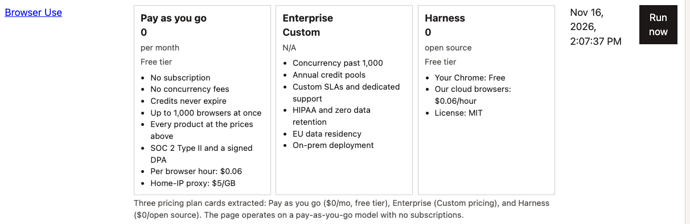
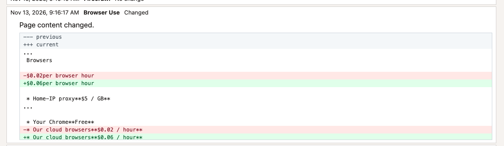

# Competitor pricing tracker

Tracks TinyFish competitor pricing pages. A setup script stores a snapshot and creates one daily Page Monitor per competitor. The dashboard shows the current plans and a change feed.

## Example

This is a snapshot of [Browser Use's](https://browser-use.com/pricing) pricing page on `Nov 13, 2026, 9:16:17 AM`





## Install

Requires Node 22.13 or newer and pnpm.

```bash
pnpm install
cp .env.example .env
```

Put a personal TinyFish API key in `TINYFISH_API_KEY`. Create one at https://agent.tinyfish.ai/api-keys. Team keys cannot manage Monitors.

## Run the dashboard

```bash
pnpm run dev
```

Open http://localhost:3000.

## Webhook tunnel

TinyFish only posts webhooks for scheduled runs, and only to a public URL. Run now does not send a webhook. The button writes the feed from the run response.

1. Start the app with `pnpm run dev`.
2. In another terminal: `ngrok http 3000`
3. Copy the `https://….ngrok-free.app` address from the Forwarding line into `PUBLIC_BASE_URL` in `.env`. No path and no trailing slash.
4. Run `pnpm run setup` if needed.


> Run pnpm run setup in these cases:

1. Once, the first time, to create the monitors and the first snapshots.
2. Again when the ngrok address in PUBLIC_BASE_URL changes.
3. Again after you add a competitor.

Leave ngrok running to receive the 8:00 AM Pacific delivery. That address changes each time you restart ngrok, so set `PUBLIC_BASE_URL` again and rerun setup. Also rerun setup after you add a competitor. A live webhook cannot be forced from Run now.

## Setup and teardown

```bash
pnpm run setup
pnpm run teardown
```

Setup fetches each pricing page, extracts plans, and creates a monitor only when that URL is not already monitored. Running it again does not create duplicates. When `PUBLIC_BASE_URL` is set, a second run attaches or updates the webhook.

Teardown deletes only monitors whose URL is in `competitors.json`.

Each completed monitor run costs $0.005 plus one Fetch. Fetch is free for 1,000 URLs per day. Plan extraction uses TinyAgent and draws from the wallet, capped at 12 steps and 90 seconds per page. Setup runs once per competitor. Later extractions run only after a real content change.

## Add a competitor

Add an object to `competitors.json`:

```json
{
  "id": "example",
  "name": "Example",
  "pricingUrl": "https://example.com/pricing",
  "notes": "Optional.",
  "includeSelectors": ["main"],
  "excludeSelectors": ["nav", "footer"]
}
```

`id` is lowercase letters, numbers, and hyphens. `includeSelectors` and `excludeSelectors` are optional. A selector that matches nothing fails that monitor run, so leave them off unless the page is noisy.

Then run `pnpm run setup`.

Changing a pricing URL does not edit the existing monitor. TinyFish fixes the URL at creation. Run teardown, change `competitors.json`, then setup again.

## How it works

- **Fetch** `POST https://api.fetch.tinyfish.ai` stores the pricing page as markdown. Pages are rendered, so JavaScript pricing still comes through. This is the baseline snapshot.
- **TinyAgent** `POST https://agent.tinyfish.ai/v1/automation/run-async` with `output_schema` turns the page into plan name, price, billing unit, limits, and free tier. Fetch JSON is a document tree, not a pricing schema, so the schema goes to TinyAgent. The app polls `GET /v1/runs/{id}` until the run finishes.
- **Monitors** `POST /v1/monitors` watches each pricing URL. The schedule is `CRON_TZ=America/Los_Angeles 0 8 * * *`. The purpose asks TinyFish to flag pricing, limits, and free-tier changes and ignore layout and copy tweaks. `GET /v1/monitors` makes setup idempotent. `PATCH /v1/monitors/{id}` updates the webhook. `DELETE /v1/monitors/{id}` is teardown.
- **Run now** `POST /v1/monitors/{id}/runs` checks one page immediately. The response has the new markdown and no diff, and TinyFish does not call the webhook. The app diffs it locally and writes the feed.
- **Webhook** `POST /api/webhooks/tinyfish` receives scheduled runs. The payload includes `fetch_monitor_id`, run `id`, `outcome` (`baseline`, `changed`, or `unchanged`), `diff`, and `judgment`. The same run id is stored once, so TinyFish retries do not duplicate the feed.

Data is stored in `data/tracker.sqlite`. There is no login and no separate database server.
